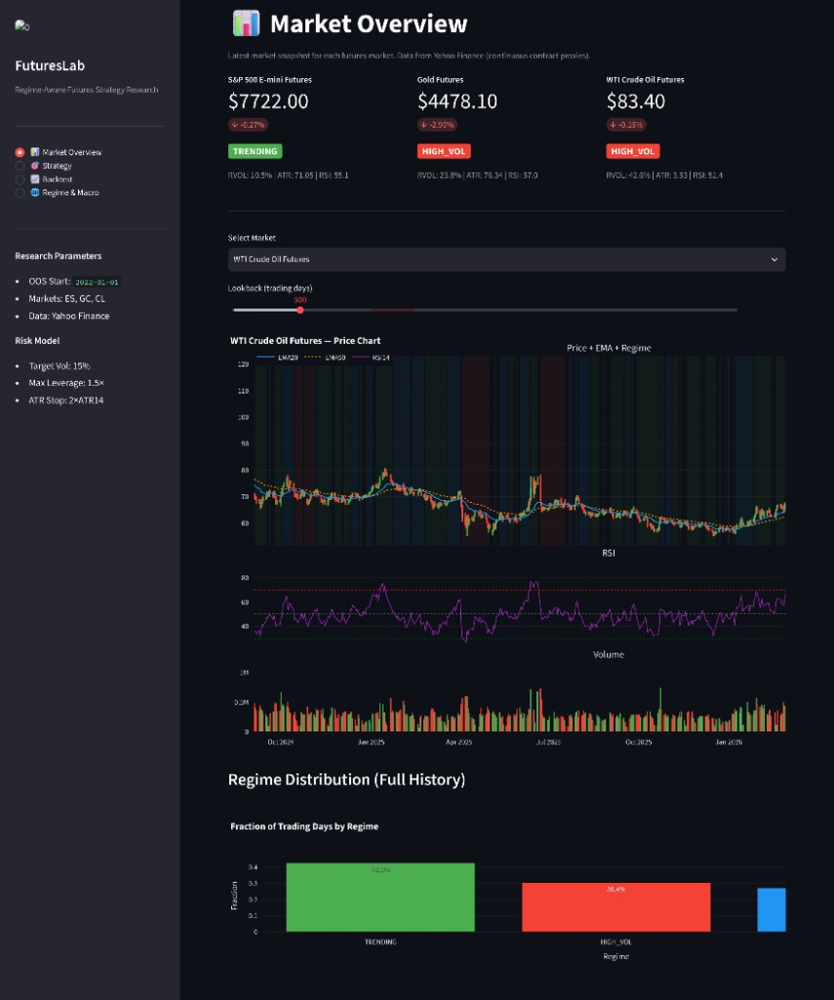
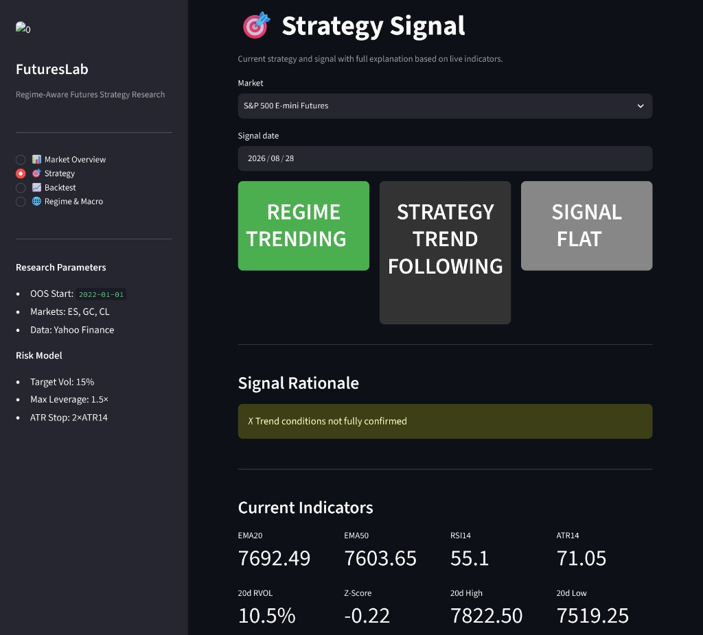
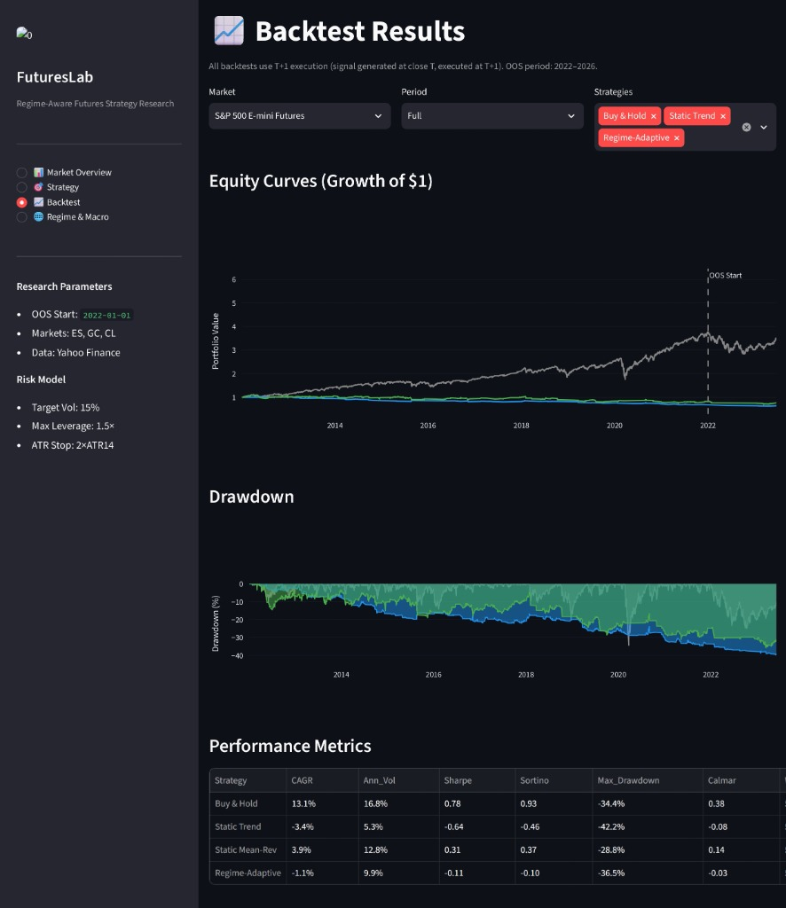
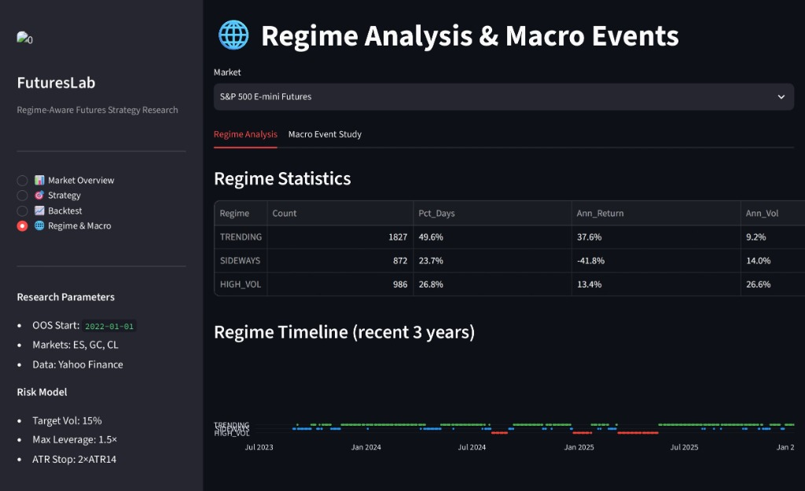

Quantitative Futures Trading & Risk Management
FuturesLab is a complete, end-to-end quantitative research pipeline exploring regime-adaptive trading strategies across major futures markets (S&P 500, Gold, Crude Oil).

This project was built to demonstrate proficiency in quantitative research, systematic trading, risk management, and Python software engineering, specifically targeting a quantitative internship role.

## 🚀 Project Overview

The core hypothesis is that financial markets transition between distinct "regimes" (Trending, Sideways, High Volatility), and a trading strategy should adapt its signal generation and risk sizing dynamically based on the current regime.

### 📸 Dashboard Preview
Below are screenshots from the interactive Streamlit dashboard built for this project:

| Market Overview | Strategy Signal |
|:---:|:---:|
|  |  |

| Backtest Results | Regime Analysis |
|:---:|:---:|
|  |  |

### Key Features
* **Data Pipeline**: Automated data acquisition via Yahoo Finance (`ES=F`, `GC=F`, `CL=F`), robust cleaning, and Parquet storage.
* **Feature Engineering**: Modular calculation of EMA spreads, RSI, ATR, Realized Volatility, Rolling Z-Scores, and Breakout channels.
* **Regime Classification**: Unsupervised, rule-based classifier assigning each day to TRENDING, SIDEWAYS, or HIGH_VOL (using strictly point-in-time expanding thresholds to prevent lookahead bias).
* **Strategy Engine**: Implements Static Trend, Static Mean-Reversion, and a Regime-Adaptive composite strategy.
* **Risk Management**: Volatility-targeting position sizing and dynamic ATR-based stop losses.
* **Backtesting**: Rigorous vectorised backtest engine with strict T+1 execution to eliminate look-ahead bias, fully accounting for transaction costs (7 bps round-trip).
* **Macro Event Study**: Analysis of price action around FOMC, CPI, and EIA events.
* **Interactive Dashboard**: Streamlit app for visualizing market regimes, strategy signals, equity curves, and macro event studies.
* **Unit Testing**: Comprehensive `pytest` suite ensuring indicator correctness and absence of lookahead bias.

## 📊 Backtest Performance (Out-of-Sample: 2022–2026)

*Note: The Regime-Adaptive strategy uses a 15% volatility target and includes 7 bps of transaction costs per trade.*

| Market | Strategy | CAGR | Ann. Vol | Sharpe | Max Drawdown | Win Rate |
|--------|----------|------|----------|--------|--------------|----------|
| **ES** (S&P 500) | Buy & Hold | 11.0% | 17.3% | 0.63 | -25.0% | 52.3% |
| | Regime-Adaptive | 0.8% | 9.5% | 0.09 | -16.1% | 53.2% |
| **GC** (Gold) | Buy & Hold | 21.3% | 19.3% | 1.10 | -25.1% | 54.9% |
| | Regime-Adaptive | 0.5% | 10.2% | 0.05 | -18.1% | 54.2% |
| **CL** (Crude) | Buy & Hold | 2.3% | 41.6% | 0.05 | -55.3% | 52.1% |
| | Regime-Adaptive | -6.4% | 9.9% | -0.64 | -39.6% | 47.2% |

**Research Conclusion:** The Regime-Adaptive strategy significantly reduces volatility and maximum drawdowns compared to Buy & Hold (e.g., CL drawdown reduced from 55% to 39%). However, the high transaction costs (7 bps) combined with the strategy's turnover heavily drag down the absolute CAGR. The strategy succeeds as a volatility-reduction and tail-risk mitigation overlay rather than a pure alpha generator in highly efficient markets.

## 🛠️ Installation & Usage

### 1. Setup Environment
```bash
python -m venv venv
source venv/bin/activate  # On Windows: venv\Scripts\activate
pip install -r requirements.txt
```

### 2. Run the Full Research Pipeline
This will download data, compute features, run backtests, execute robustness tests, and generate charts.
```bash
python run_research.py
```
Outputs are saved to `data/processed/` and `reports/figures/`.

### 3. Launch the Interactive Dashboard
```bash
streamlit run app.py
```
Navigate to `http://localhost:8501` to view the interactive market overview, current strategy signals, and backtest results.

### 4. Run Unit Tests
```bash
pytest tests/ -v
```

## 📂 Repository Structure

```text
FuturesLab/
├── data/
│   ├── raw/             # Raw CSV data from Yahoo Finance
│   └── processed/       # Cleaned Parquet data and backtest results
├── reports/
│   ├── figures/         # Generated charts (equity curves, drawdowns, etc.)
│   ├── FuturesLab_Research_Report.md
│   ├── Interview_Preparation.md
│   └── Research_Decision_Log.md
├── src/                 # Core Python modules
│   ├── __init__.py
│   ├── config.py        # Global parameters and thresholds
│   ├── data.py          # Data ingestion and cleaning
│   ├── features.py      # Technical indicators (EMA, RSI, ATR, etc.)
│   ├── regimes.py       # Market regime classification logic
│   ├── strategies.py    # Signal generation algorithms
│   ├── risk.py          # Vol-targeting and stop-loss logic
│   ├── backtest.py      # T+1 execution backtest engine
│   ├── evaluation.py    # Performance metrics (Sharpe, MaxDD, etc.)
│   └── macro.py         # Event study logic (FOMC, CPI, EIA)
├── tests/               # Unit tests (pytest)
├── app.py               # Streamlit dashboard application
├── run_research.py      # Main pipeline execution script
├── requirements.txt     # Python dependencies
└── README.md
```

## 📝 License
This project is open-source and available under the MIT License.
